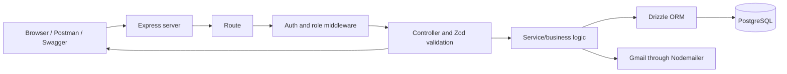
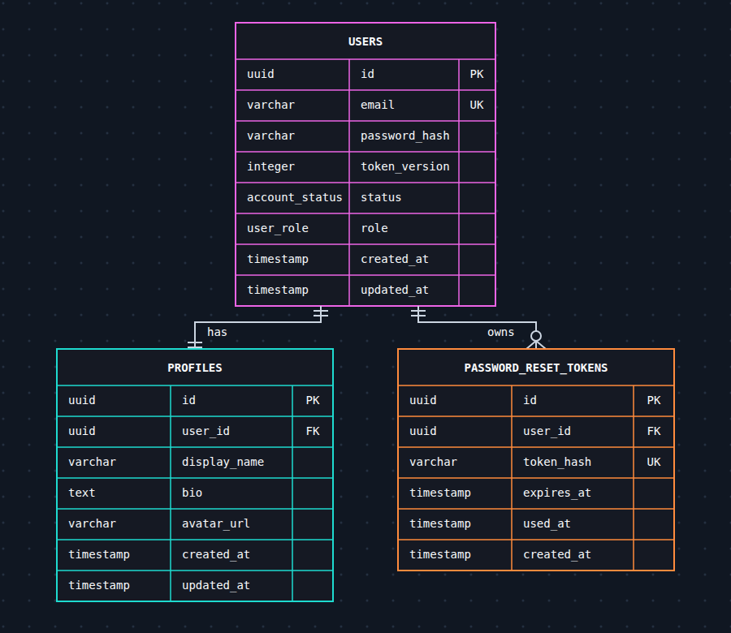
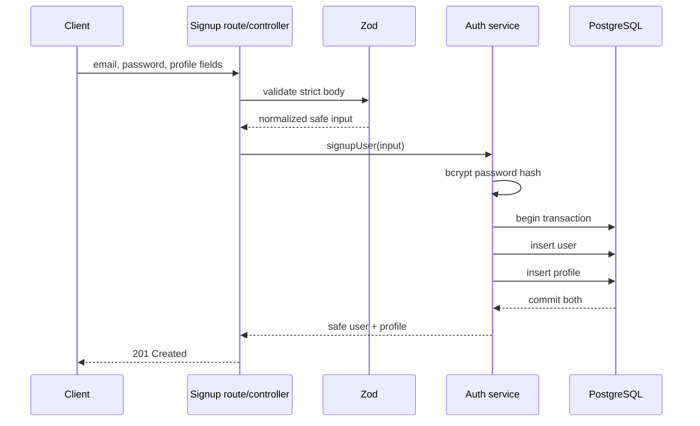

# Express Task API — Beginner's Complete Project Guide

This guide explains the project as if you are seeing backend development for the first time. It describes what each part does, how data moves through the application, why the security decisions exist, and how the pieces work together.

Read it in order once. Later, use the headings as a reference while reading the code.

## 1. What did we build?

We built a backend application for managing user accounts.

A backend is software that receives requests, applies rules, reads or changes stored data, and sends responses. It does not normally draw the application's main user interface.

This backend can:

- create user accounts;
- sign users in and out;
- return and update profiles;
- change passwords;
- email password-reset links to logged-out users;
- temporarily deactivate and reactivate accounts;
- permanently delete accounts;
- distinguish normal users from administrators;
- let administrators search and manage other users;
- prevent the final active administrator from being removed;
- describe and test its API through Swagger and Postman.

The project is API-focused. The only small web page it serves is the password-reset form opened from an email link.

## 2. Important vocabulary

You will understand the project more easily if these terms are clear.

### Client

Anything that sends a request to the backend. A client could be:

- a browser;
- a mobile application;
- a frontend website;
- Postman;
- Swagger UI;
- `curl` in a terminal.

### Server

The running Node.js program that listens for requests. In development it normally listens at `http://localhost:5000`.

### API

API means Application Programming Interface. In this project, it means a collection of HTTP URLs that clients can call.

For example:

```text
POST /api/v1/auth/signin
```

### Endpoint

One HTTP method plus one path. These are different endpoints even though the path is similar:

```text
GET /api/v1/users/me
DELETE /api/v1/users/me
```

### HTTP method

The method communicates the intention:

- `GET`: read data;
- `POST`: create something or perform an action;
- `PATCH`: partially update something;
- `DELETE`: delete something.

### Request and response

A request travels from the client to the server. It can contain headers, URL parameters, query parameters, and a body.

A response travels back from the server. It contains an HTTP status code and usually JSON data.

### JSON

JSON is a text format used to transfer structured data:

```json
{
  "email": "user@example.com",
  "password": "TestPassword123!"
}
```

### Route

A route connects an HTTP method and path to code that handles it.

### Middleware

Middleware is code that runs between receiving a request and running the final controller. Authentication and authorization are implemented as middleware.

### Controller

A controller handles HTTP concerns. It validates request input, calls a service, selects the status code, and constructs the response.

### Service

A service contains business logic. Examples include checking passwords, creating users transactionally, changing roles, or locking administrators before a sensitive update.

### Database

The database permanently stores users, profiles, and password-reset tokens. This project uses PostgreSQL.

### ORM

ORM means Object-Relational Mapper. Drizzle lets TypeScript code describe tables and build SQL queries with type checking.

### Schema

A database schema defines tables, columns, types, constraints, and relationships.

### Migration

A migration is a numbered SQL change that moves a database from one version to the next.

### Authentication

Authentication answers: **Who are you?**

Signing in with an email and password is authentication.

### Authorization

Authorization answers: **What are you allowed to do?**

An authenticated normal user is not authorized to call administrator endpoints.

### Hash

A hash is a one-way transformation. The application stores password hashes instead of plain passwords. It also stores reset-token hashes instead of the reset tokens sent by email.

### JWT

JWT means JSON Web Token. After signin, the server signs a short-lived access token. The client sends that token with future protected requests.

### Transaction

A transaction groups database operations into one unit. Either every operation succeeds, or PostgreSQL rolls them all back.

### Foreign key and cascade

A foreign key connects one table to another. A cascade means that deleting a user automatically deletes records that belong to that user.

## 3. The big picture



Most requests follow this sequence:

1. A client sends an HTTP request.
2. Express matches the request to a route.
3. Protected routes run authentication middleware.
4. Admin routes additionally run authorization middleware.
5. A controller validates the input with Zod.
6. The controller calls a service.
7. The service reads or changes PostgreSQL through Drizzle.
8. The controller sends a safe response.
9. If anything fails, centralized error middleware formats the error.

## 4. Main technologies and why they were chosen

### Node.js

Node.js runs JavaScript and TypeScript applications outside a browser. It is the runtime for the backend.

### TypeScript

TypeScript adds static types to JavaScript. It catches many mistakes before the program runs.

Strict compiler options are enabled in `tsconfig.json`, including:

- `strict`;
- `noUncheckedIndexedAccess`;
- `exactOptionalPropertyTypes`;
- `noImplicitReturns`;
- `noFallthroughCasesInSwitch`.

These settings make the compiler more demanding, but they reduce hidden mistakes.

The project uses ECMAScript modules (`"type": "module"`) and TypeScript's `NodeNext` module mode. That is why local imports end in `.js` even inside `.ts` files:

`"type": "module"` is a setting in `package.json` that tells Node.js how to interpret your `.js` files: as **ECMAScript modules (ESM)** instead of the older **CommonJS** format.

## The two module systems

JavaScript has two ways to split code across files and share things between them.

**CommonJS (the old default in Node):**

```js
const express = require("express");
module.exports = app;
```

**ES modules (the modern standard, same as browsers use):**

```js
import express from "express";
export default app;
```

Without `"type": "module"`, Node treats `.js` files as CommonJS, so `import` statements would throw a syntax error. Setting it flips the default so `import`/`export` work.

## What it changes in practice

- You use `import` and `export` instead of `require` and `module.exports`.
- Local imports need the file extension spelled out, which is why the document says imports end in `.js` even inside `.ts` files:
  ```ts
  import app from "./app.js";
  ```
  CommonJS would let you write `./app` and guess the extension. ESM does not guess.
- Variables like `__dirname` and `__filename` don't exist. You have to derive them another way.
- Top-level `await` works, so you can use `await` outside a function.

## How it connects to TypeScript here

The project pairs `"type": "module"` with TypeScript's `NodeNext` module mode. That setting makes the TypeScript compiler follow Node's real ESM rules. So when you write `./app.js` in a `.ts` file, TypeScript knows it means `app.ts` while developing, and the compiled output correctly points at `app.js`.

## Why bother choosing ESM

It is the official JavaScript standard, it matches how frontend code is written, and newer libraries increasingly ship ESM-only. Starting a new project with it avoids having to migrate later.

If you'd like, I can show what `package.json` and `tsconfig.json` look like together for this setup.

```ts
import app from "./app.js";
```

TypeScript understands that this refers to `app.ts` while developing and emits an import that correctly points to `app.js` after compilation.

### Express 5

Express receives HTTP requests and connects paths to functions. Express does **not** include a built-in user or role system. Authentication and authorization must be designed by the application or supplied by another library.

Express 5 also understands rejected promises from async route handlers and forwards those errors to error middleware.

### PostgreSQL

PostgreSQL is a relational database. It provides transactions, constraints, row locking, enums, foreign keys, and reliable persistence.

### Drizzle ORM and Drizzle Kit

Drizzle ORM builds typed database queries. Drizzle Kit compares TypeScript schemas with migration snapshots and generates SQL migrations.

### Connection pooling

A database connection is an open communication channel between the Node.js application and PostgreSQL. Opening a brand-new connection for every API request would add delay and waste database resources.

Connection pooling keeps a small collection of reusable connections. When a query arrives, it uses an available connection from the pool. After the query finishes, that connection becomes available for another query instead of being destroyed.

This project already uses connection pooling through Postgres.js. The pool is created in `src/db/index.ts`:

```ts
const client = postgres(connectionString);

export const db = drizzle(client, {
  schema: {
    users,
    profiles,
    passwordResetTokens,
  },
});
```

`postgres(connectionString)` does more than create one connection. It creates a Postgres.js client that manages a pool automatically. Drizzle receives that pooled client and uses it for all database queries.

```text
API requests
    ↓
Drizzle queries
    ↓
Postgres.js connection pool
    ├── connection 1 → PostgreSQL
    ├── connection 2 → PostgreSQL
    └── connection 3 → PostgreSQL
```

Connections are opened lazily, meaning Postgres.js opens them when work requires them rather than opening every possible connection immediately. With the currently installed Postgres.js version, the default maximum is 10 connections.

If all connections are busy, additional queries wait or are scheduled through the pool until capacity is available. This lets several API requests use PostgreSQL concurrently while preventing the application from creating an unlimited number of connections.

Transactions still remain safe. When code calls `db.transaction(...)`, every query inside that transaction uses the same reserved database connection until the transaction commits or rolls back. Transaction queries are not distributed across unrelated pooled connections.

The project does not install a second pooling package because that would create unnecessary overlapping pools. For local development, the Postgres.js default is sufficient. Before a larger deployment, the maximum should be selected according to the database provider's connection limit and the number of running application instances:

```text
maximum possible connections = application instances × pool maximum
```

For example, three application instances with a maximum of ten connections each could use up to thirty PostgreSQL connections. Pool size is therefore a deployment capacity decision, not simply “the larger, the better.”

### Zod

Zod validates data at runtime. TypeScript types disappear after compilation, so they cannot protect the server from malformed network input. Zod provides that runtime protection.

### bcrypt

bcrypt hashes passwords using a deliberately expensive calculation. This makes stolen password hashes harder to crack by brute force.

Hashing is different from encryption. Encryption is designed to be reversed using a key. A password should not need to be recovered, so the server stores a one-way hash and asks bcrypt whether a submitted password matches it. bcrypt also stores a random salt inside the resulting hash, preventing identical passwords from producing identical stored values.

Reset tokens use SHA-256 rather than bcrypt because they are already random 32-byte secrets with extremely high entropy. Passwords are human-chosen and need bcrypt's deliberately slow calculation; random reset tokens do not.

### jsonwebtoken

This library creates and verifies JWT access tokens.

### Nodemailer and Gmail

Nodemailer connects to Gmail and sends password-reset links. Gmail was selected as a simple learning-project solution that does not require a custom sending domain. It is not the preferred choice for a high-volume production service.

### Swagger/OpenAPI

`openapi.yaml` describes the endpoints, inputs, responses, security, and schemas. Swagger UI turns that file into interactive browser documentation.

### Postman

The Postman collection provides reusable requests and automated assertions for the API.

### Docker

Docker Compose runs PostgreSQL in a consistent isolated container. The Node.js application still runs locally during development.

## 5. Project structure

```text
src/
  app.ts                         Builds the Express application
  server.ts                      Starts listening on a port
  config/env.ts                  Loads and validates environment settings
  controllers/                  HTTP handlers
  db/index.ts                    PostgreSQL connection and Drizzle instance
  db/schema/                     Current database schema
  docs/swagger.ts                Loads openapi.yaml
  errors/app-error.ts            Expected application error class
  middlewares/                   Authentication and error middleware
  routes/                        Endpoint definitions
  scripts/seed-admin.ts          Creates the first trusted administrator
  services/                      Business and database logic
  types/express.d.ts             Adds req.user to Express's TypeScript type
  utils/security-tokens.ts       Creates and hashes reset tokens
  validators/                    Zod request schemas

drizzle/                         Migration history and snapshots
docs/
  assets/database-erd.png        Rendered database relationship diagram
postman/                         Postman collection and environment
openapi.yaml                     API contract
docker-compose.yml               PostgreSQL container
.env.example                     Safe configuration template
```

### Why separate these folders?

Separation makes each file responsible for one kind of work:

- routes decide **which function runs**;
- controllers deal with **HTTP**;
- validators decide **whether input is valid**;
- services implement **business rules**;
- schemas describe **database structure**;
- middleware handles **cross-cutting rules** such as authentication.

This prevents one enormous file from mixing every concern.

# Layer-first vs feature-first project structure

## The difference

Both approaches organize the same code. They differ in which question the top-level folders answer.

**Layer-first** asks: _what kind of code is this?_ Files are grouped by technical role.

```text
src/
  controllers/   auth.controllers.ts, user.controllers.ts, admin.controllers.ts
  services/      auth.service.ts, user.service.ts, admin.service.ts
  routes/        auth.routes.ts, user.routes.ts, admin.routes.ts
  validators/    auth.validators.ts, ...
```

**Feature-first** asks: _what part of the product is this?_ Files are grouped by the capability they serve.

```text
src/
  modules/
    auth/    auth.routes.ts, auth.controllers.ts, auth.validators.ts, auth.service.ts
    users/   ...
    admin/   ...
  shared/    middlewares/, errors/, config/
```

|                               | Layer-first                   | Feature-first                             |
| ----------------------------- | ----------------------------- | ----------------------------------------- |
| Top-level folders             | Technical roles               | Product features                          |
| Changing one feature          | Touch several folders         | Touch one folder                          |
| Finding "all the controllers" | One folder                    | Spread across modules                     |
| Shared code                   | Naturally in place            | Needs a deliberate `shared/` area         |
| Best for                      | Small projects, learning      | Larger projects, teams                    |
| Main risk                     | Folders get crowded over time | Features importing each other in a tangle |

## Why this project uses layers

The document doesn't state this decision explicitly, so the reasons below are inferred from its goals and size rather than quoted from it.

1. **It is a learning project.** The guide teaches the request journey as route, middleware, controller, service, database. Layer folders mirror that sequence, so the structure itself reinforces the lesson. Each folder has one job, and the guide says as much: separation keeps one enormous file from mixing every concern.
2. **It is small.** There are only three areas (auth, users/profile, admin). At that size, each layer folder holds just a few files, so the usual downside of crowding doesn't appear yet.
3. **Shared pieces have an obvious home.** Authentication middleware, the error handler, and `AppError` are used by every feature. In a layer structure they simply sit in their own folders without extra design decisions.
4. **Features aren't isolated from each other.** Admin and user operations touch the same tables, and the last-admin protection and token-version logic cut across features. Strict feature boundaries would have forced awkward cross-module imports.
5. **Switching later is cheap.** Because files are already named by feature, moving to modules would be mostly relocating files and updating imports, with no logic changes. Choosing layers now doesn't lock the project in.

## When to switch

Move to feature folders if the project grows past roughly eight to ten features, if several people work on it at once, or if you find yourself constantly jumping across four folders to change a single feature.

The principle that matters under either layout is the same: keep HTTP handling, business logic, and data access separate.

## 6. How the application starts

### Step 1: `src/server.ts`

`server.ts` imports the Express application and calls `app.listen(...)`.

The port comes from `PORT`; otherwise it uses 5000.

### Step 2: `src/app.ts`

`app.ts` creates and configures Express:

- disables the `X-Powered-By` header so the server reveals less implementation information;
- accepts JSON bodies up to 100 KB;
- accepts small URL-encoded form bodies up to 10 KB for the reset form;
- serves the root check, OpenAPI file, reset page, and Swagger UI;
- mounts all routers;
- installs the 404 handler;
- installs the final error handler.

Order matters. Error handling must come after the routes because it handles errors produced by those routes.

### Step 3: configuration validation

Importing `src/config/env.ts` loads `.env` through `dotenv` and validates settings.

The server refuses to start if:

- `JWT_SECRET` is missing or shorter than 32 characters;
- `JWT_EXPIRES_IN` is malformed;
- bcrypt rounds are outside 10–15;
- only one of the two Gmail variables is provided;
- `APP_BASE_URL` is not an absolute URL.

Failing early is better than discovering a bad configuration during a user request.

## 7. Environment variables

Environment variables keep deployment-specific settings and secrets outside source code.

### Database

- `POSTGRES_USER`, `POSTGRES_PASSWORD`, `POSTGRES_DB`: configure the Docker database.
- `DATABASE_URL`: tells the application and Drizzle how to connect.

### Server

- `PORT`: HTTP port, default 5000.

### JWT

- `JWT_SECRET`: secret used to sign access tokens.
- `JWT_EXPIRES_IN`: lifetime such as `15m`.
- `JWT_ISSUER`: identifies the token issuer.
- `JWT_AUDIENCE`: identifies the intended client.

### Password hashing

- `BCRYPT_SALT_ROUNDS`: bcrypt work factor. The default is 12.

### Gmail password reset

- `SMTP_USER`: dedicated Gmail account.
- `SMTP_APP_PASSWORD`: Gmail App Password, not the normal Gmail password.
- `APP_BASE_URL`: origin placed at the beginning of reset links.

Local example:

```dotenv
APP_BASE_URL=http://localhost:5000
```

Deployed example:

```dotenv
APP_BASE_URL=https://api.example.com
```

### Admin seed

- `ADMIN_EMAIL`;
- `ADMIN_PASSWORD`;
- `ADMIN_DISPLAY_NAME`.

These are used only by `npm run seed:admin`. The admin password should be removed from `.env` after bootstrapping.

Never commit `.env`. `.env.example` contains names and placeholders, not real secrets.

## 8. Database design

The final database has three public tables.



<details>
<summary>View the editable Mermaid source</summary>

```mermaid
erDiagram
    USERS ||--|| PROFILES : has
    USERS ||--o{ PASSWORD_RESET_TOKENS : owns

    USERS {
      uuid id PK
      varchar email UK
      varchar password_hash
      integer token_version
      account_status status
      user_role role
      timestamptz created_at
      timestamptz updated_at
    }

    PROFILES {
      uuid id PK
      uuid user_id FK_UK
      varchar display_name
      text bio
      varchar avatar_url
      timestamptz created_at
      timestamptz updated_at
    }

    PASSWORD_RESET_TOKENS {
      uuid id PK
      uuid user_id FK
      varchar token_hash UK
      timestamptz expires_at
      timestamptz used_at
      timestamptz created_at
    }
```

</details>

### `users`

This table stores account and security information.

- `id`: randomly generated UUID primary key.
- `email`: unique, required, trimmed/lowercase email.
- `password_hash`: bcrypt hash; never the original password.
- `token_version`: integer used to invalidate JWTs.
- `status`: `active` or `deactivated`.
- `role`: `user` or `admin`.
- `created_at`, `updated_at`: timestamps.

The database has a check constraint requiring email to equal its lowercase trimmed value. Validation also normalizes email, but the database constraint prevents another database client from bypassing the rule.

### `profiles`

Profile data is separated from security-sensitive user data.

- `user_id` is unique, creating a one-to-one relationship.
- `display_name` is required.
- `bio` and `avatar_url` are optional.

Deleting a user cascades to the profile.

### `password_reset_tokens`

This table supports forgotten-password recovery.

- `user_id`: owner of the token.
- `token_hash`: SHA-256 hash of the emailed token.
- `expires_at`: reset deadline.
- `used_at`: non-null after invalidation or use.
- `created_at`: audit timestamp for the record.

The raw token is never stored. If the database is leaked, an attacker cannot simply copy a token from this table and reset a password.

Deleting a user cascades to all reset-token records.

## 9. Migrations and the project's history

Migration files are permanent history:

- `0000`: original user/profile schema;
- `0001`: account lifecycle and the original broader email-token system;
- `0002`: `user`/`admin` roles;
- `0003`: removed the broader email-delivery system and its unused structures;
- `0004`: added back only the small password-reset-token table required for Gmail reset links.

Why not edit `0001` after changing the decision?

Because it had already been applied. Editing applied migrations causes existing databases and fresh databases to follow different histories. Instead, `0003` and `0004` honestly record how the project evolved.

On a fresh database, Drizzle applies all five in order and reaches the same final three-table schema.

Useful commands:

```bash
npx drizzle-kit generate
npx drizzle-kit migrate
npx drizzle-kit check
```

## 10. Signup flow

Endpoint:

```text
POST /api/v1/auth/signup
```



Important decisions:

- Zod's `.strict()` rejects extra fields, so public signup cannot accept `role`.
- Email is trimmed and lowercased.
- Passwords are limited to 72 UTF-8 bytes because bcrypt ignores bytes after its limit.
- User and profile creation share a transaction. The application cannot accidentally create a user without a profile.
- The role defaults to `user` in PostgreSQL.
- The response excludes `passwordHash` and `tokenVersion`.

## 11. Signin and JWT flow

Endpoint:

```text
POST /api/v1/auth/signin
```

The service:

1. finds the normalized email;
2. uses `bcrypt.compare` against the stored hash;
3. rejects incorrect email/password with the same message;
4. rejects a deactivated account;
5. signs a JWT.

The token contains:

- `sub`: user ID;
- `tokenVersion`: current database token version;
- `iat`: issued-at time;
- `exp`: expiration time;
- issuer and audience values.

The role is intentionally **not** stored in the JWT. A role in a JWT could remain stale until expiry. Loading the current database role on every protected request makes promotion or demotion effective immediately.

The client sends the token like this:

```http
Authorization: Bearer eyJ...
```

## 12. Authentication middleware

`authenticate` in `src/middlewares/auth.middlewares.ts` protects private endpoints.

It performs these checks:

1. The `Authorization` header must contain exactly one Bearer token.
2. The JWT signature must be valid using HS256.
3. Issuer and audience must match.
4. The token must not be expired.
5. `sub` must be a UUID-shaped string.
6. `tokenVersion` must be a non-negative integer.
7. The user must still exist.
8. The database token version must match.
9. The account must be active.

It then attaches this trusted object:

```ts
req.user = {
  id: user.id,
  email: user.email,
  role: user.role,
};
```

`src/types/express.d.ts` teaches TypeScript that Express requests may contain `req.user`.

## 13. Session invalidation with `tokenVersion`

JWTs are normally valid until they expire. That creates a problem: how can signout or a password change invalidate an already-issued token?

The project solves this with `tokenVersion`.

Example:

```text
Database tokenVersion = 3
JWT tokenVersion      = 3  -> accepted

User signs out
Database tokenVersion = 4
Old JWT tokenVersion  = 3  -> rejected with 401
```

The version increases after:

- signout;
- password change;
- password reset;
- role change;
- deactivation;
- reactivation.

This invalidates all older access tokens without storing every JWT in the database.

## 14. Authorization and roles

After authentication, `authorizeRoles("admin")` checks the role loaded from PostgreSQL.

- Missing authentication produces 401.
- An authenticated normal user produces 403.
- An authenticated admin continues to the controller.

The distinction matters:

- 401 means “the server cannot authenticate you.”
- 403 means “the server knows who you are, but you lack permission.”

All `/api/v1/admin` routes run both middleware functions.

## 15. Profiles

Endpoints:

```text
GET   /api/v1/users/me/profile
PATCH /api/v1/users/me/profile
```

Both require authentication.

The update validator:

- allows only `displayName`, `bio`, and `avatarUrl`;
- rejects unknown fields;
- requires at least one field;
- limits display name to 100 characters;
- limits bio to 1000 characters;
- validates the avatar as a URL.

The service joins `profiles` with `users` when reading so the response can include the authoritative account email without duplicating it inside the profile table.

## 16. Logged-in password change

Endpoint:

```text
PATCH /api/v1/users/me/password
```

The user must provide:

- current password;
- new password.

The service verifies the current password, rejects an unchanged password, hashes the new password, updates the user, and increments `tokenVersion`.

Requiring the current password protects a logged-in session left open on someone else's device.

## 17. Forgotten-password flow

This flow exists for a logged-out user who cannot provide the current password.

### Requesting the email

Endpoint:

```text
POST /api/v1/auth/forgot-password
```

The client sends only the email.

If Gmail is not configured, the endpoint returns 503 before looking up the account. This reveals a global configuration problem but does not reveal whether a particular email exists.

If Gmail is configured:

1. the service looks for an active account;
2. missing/deactivated accounts still receive the generic 200 response;
3. outstanding unused tokens for the user are marked used;
4. a cryptographically random 32-byte token is created;
5. only its SHA-256 hash is stored;
6. expiry is set to 30 minutes;
7. Nodemailer sends a link through Gmail.

The response remains generic:

```text
If an eligible account exists, password reset instructions will be sent
```

This reduces account enumeration. Account enumeration is when an attacker tests emails to learn which people have accounts.

If Gmail rejects delivery, the new database token is invalidated. The log records only the error type—not the recipient, token, message, or credentials.

### Clicking the link

The email contains:

```text
{APP_BASE_URL}/reset-password?token=...
```

`GET /reset-password` validates the token's format and serves a minimal HTML form.

The page includes defensive headers:

- `Cache-Control: no-store`;
- Content Security Policy;
- `Referrer-Policy: no-referrer`;
- `X-Content-Type-Options: nosniff`.

The token is a validated 64-character hexadecimal value before it is inserted into the hidden form field.

### Submitting the new password

The browser form submits to:

```text
POST /reset-password
```

API clients can instead use JSON:

```text
POST /api/v1/auth/reset-password
```

The reset service:

1. hashes the supplied raw token;
2. finds the matching record;
3. rejects missing, used, or expired tokens;
4. hashes the new password before opening the critical transaction;
5. locks the token row;
6. validates it again to prevent two simultaneous uses;
7. updates the password;
8. increments `tokenVersion`;
9. marks all outstanding reset tokens for that user as used.

The second validation inside a locked transaction protects against a race where two requests try to use the same token at the same time.

## 18. Signout, deactivation, reactivation, and deletion

### Signout

`POST /api/v1/auth/signout` increments `tokenVersion`. The client should also discard its local token.

### Deactivation

`POST /api/v1/users/me/deactivate` requires authentication and current-password confirmation.

It changes status to `deactivated` and increments `tokenVersion`. Data remains stored.

### Reactivation

`POST /api/v1/auth/reactivate` is public because the account's old JWT is no longer usable. It requires correct email and password.

It changes status back to `active` and increments `tokenVersion` again.

### Permanent deletion

`DELETE /api/v1/users/me` requires authentication and current-password confirmation.

It deletes the user. PostgreSQL cascades to the profile and reset tokens. This cannot be undone without a database backup.

## 19. Administrator bootstrap

Public signup must never accept `role: "admin"`. Otherwise anyone could make themselves an administrator.

The first admin is created with:

```bash
npm run seed:admin
```

The seed:

- validates environment input with the same email/password/profile rules;
- hashes the password;
- creates the admin and profile transactionally;
- does nothing if that email is already an admin;
- refuses to promote an existing normal account.

This operation requires trusted access to the server environment and database.

## 20. Administrator endpoints

All paths begin with `/api/v1/admin` and require an active database role of `admin`.

### List users

```text
GET /admin/users?page=1&limit=20&search=&role=&status=
```

- default page: 1;
- default limit: 20;
- maximum limit: 100;
- search checks email and display name case-insensitively;
- optional role/status filters;
- newest users first;
- user ID breaks timestamp ties for deterministic ordering.

The response includes pagination metadata: page, limit, total records, and total pages.

### Get one user

```text
GET /admin/users/:userId
```

Returns safe account and profile data, never hashes or token versions.

### Change role

```text
PATCH /admin/users/:userId/role
```

Only `user` and `admin` are accepted. A role change increments the target's token version.

### Deactivate/reactivate

```text
POST /admin/users/:userId/deactivate
POST /admin/users/:userId/reactivate
```

These operations enforce valid state transitions and invalidate old sessions.

### Delete

```text
DELETE /admin/users/:userId
```

Returns 204 and uses database cascades.

### Why admin endpoints cannot target the caller

Administrators cannot use admin URLs on their own ID. Self-deactivation and deletion belong to the password-confirmed `/users/me` flows. This separates privileged management of other users from management of one's own account.

## 21. Last-active-admin protection

The application must never end with zero active administrators.

Before a sensitive mutation, a transaction:

1. selects all active admins;
2. orders them by ID;
3. locks the rows with `FOR UPDATE`;
4. verifies the acting admin is still active;
5. counts the active admins;
6. rejects a change that would remove the final one.

Why lock rows?

Without locks, two administrators could simultaneously observe “two admins exist” and both deactivate themselves. Both requests might succeed, leaving zero. Row locks serialize those decisions.

Why deterministic ordering?

Always locking in the same order reduces deadlock risk when multiple transactions compete for the same rows.

## 22. Input validation

Every untrusted request value is validated before business logic.

Examples:

- emails are normalized and length-limited;
- passwords are length- and byte-limited;
- UUID path parameters must be valid UUIDs;
- page and limit must be positive integers;
- admin limit cannot exceed 100;
- role/status must be allowed enum values;
- bodies are strict, so unknown properties are rejected.

Validation errors produce HTTP 400 with field-level messages.

TypeScript alone cannot provide this protection because network JSON has no TypeScript type at runtime.

## 23. Error handling

Expected business failures use `AppError` with a status and safe message.

The final error middleware handles:

- malformed JSON -> 400;
- Zod errors -> 400 with details;
- `AppError` -> its selected status;
- PostgreSQL uniqueness -> 409;
- PostgreSQL foreign-key conflicts -> 409;
- constraint/null violations -> 400;
- unexpected errors -> generic 500.

Unexpected logs include only the error type. SQL details and sensitive input are not printed.

Common status codes:

| Code | Meaning in this project                             |
| ---- | --------------------------------------------------- |
| 200  | Request succeeded                                   |
| 201  | Account created                                     |
| 204  | Deletion succeeded; no response body                |
| 400  | Invalid input/token                                 |
| 401  | Missing/invalid authentication or wrong credentials |
| 403  | Authenticated but forbidden, or account deactivated |
| 404  | Route or target does not exist                      |
| 409  | Current state conflicts with requested action       |
| 500  | Unexpected server failure                           |
| 503  | Gmail password reset is not configured              |

## 24. Complete endpoint map

### System

- `GET /`
- `GET /api/v1/health`
- `POST /api/v1/echo`
- `GET /openapi.yaml`
- `GET /api-docs/`

### Authentication

- `POST /api/v1/auth/signup`
- `POST /api/v1/auth/signin`
- `POST /api/v1/auth/signout`
- `POST /api/v1/auth/forgot-password`
- `POST /api/v1/auth/reset-password`
- `POST /api/v1/auth/reactivate`
- `GET /reset-password`
- `POST /reset-password`

### Account/profile

- `GET /api/v1/users/me`
- `PATCH /api/v1/users/me/password`
- `POST /api/v1/users/me/deactivate`
- `DELETE /api/v1/users/me`
- `GET /api/v1/users/me/profile`
- `PATCH /api/v1/users/me/profile`

### Administration

- `GET /api/v1/admin/users`
- `GET /api/v1/admin/users/:userId`
- `PATCH /api/v1/admin/users/:userId/role`
- `POST /api/v1/admin/users/:userId/deactivate`
- `POST /api/v1/admin/users/:userId/reactivate`
- `DELETE /api/v1/admin/users/:userId`

## 25. Swagger and Postman

Swagger UI is available at:

```text
http://localhost:5000/api-docs/
```

It reads `openapi.yaml` and lets you execute requests. For protected endpoints, use the Authorize button and supply the Bearer token.

The Postman files are in `postman/`.

The automated folders:

- create a disposable user;
- capture user/admin tokens and IDs;
- verify 401 and 403 behavior;
- test search/filter/pagination;
- test role changes and session invalidation;
- test last-admin protection;
- test state changes and deletion.

Password reset is in the manual account folder because real email delivery requires your Gmail configuration.

## 26. Local development commands

```bash
npm install
docker compose up -d db
npx drizzle-kit migrate
npm run dev
```

Quality checks:

```bash
npm run typecheck
npm run build
npx drizzle-kit check
npm audit --omit=dev
```

The current `npm test` command is a placeholder. Postman and the manual QA scripts performed integration coverage, but a future production project should add automated unit and integration tests to the repository.

## 27. Deployment data flow

When deploying:

1. create a managed PostgreSQL database;
2. set `DATABASE_URL` to that database;
3. set a strong unique `JWT_SECRET`;
4. set the deployed `APP_BASE_URL`, such as `https://api.example.com`;
5. configure Gmail App Password variables;
6. run `npm install` and `npm run build`;
7. run `npx drizzle-kit migrate` once as a release step;
8. start with `npm start`;
9. seed the first admin once, then remove its password variable;
10. enforce HTTPS.

The reset email uses `APP_BASE_URL`. If it remains `localhost`, recipients will receive a link that points to their own computer rather than the deployed server.

## 28. Major design decisions

### Database-backed roles instead of JWT roles

This makes role changes immediate and prevents stale permissions.

### Short access tokens and no refresh tokens

This keeps the training project understandable. A production system may add refresh-token rotation.

### `tokenVersion` instead of a JWT blacklist

One integer invalidates all old tokens efficiently. A per-token blacklist would need storage and cleanup for every access token.

### Separate user and profile tables

Security/account data and editable presentation data have different responsibilities.

### UUIDs instead of sequential IDs

UUIDs are difficult to guess and work well across distributed systems. Authorization is still required—unguessable IDs are not a security boundary.

### Transactions for multi-step changes

They prevent partial state, such as an account without a profile.

### Row locks for last-admin safety

Counting without locks would be unsafe under concurrency.

### Password confirmation for destructive self-actions

Possession of a JWT alone is not enough to deactivate/delete the account or change the password.

### Gmail only for password reset

The earlier broader email system was intentionally simplified. Password reset remained because logged-out users need identity recovery. Other email verification and notification features were removed to keep the learning scope manageable.

### Raw tokens are not stored

Only a hash is stored, limiting damage from database exposure.

### Generic forgot-password responses

They reduce email/account enumeration.

### One tiny reset page

An email link needs somewhere for the user to enter a new password. Serving one protected form avoids requiring a full frontend application.

### Applied migrations are never rewritten

New forward migrations keep every database consistent and preserve history.

## 29. Known limitations

This is a strong training project, not a complete production identity platform.

It currently has:

- no refresh-token system;
- no multi-factor authentication;
- no rate limiting or CAPTCHA;
- no persistent admin audit-log table;
- no automated test suite committed under `npm test`;
- Gmail rather than a transactional production email provider;
- no email-address change flow;
- no email ownership verification at signup;
- no frontend except the reset form;
- no CORS policy because no separate browser frontend has been introduced;
- no scheduled cleanup job for old used/expired reset-token rows.

These are documented boundaries, not hidden surprises.

## 30. Three complete walkthroughs

### A. Normal user receives 403 from an admin endpoint

1. User signs in.
2. JWT contains user ID and token version.
3. Client calls `/api/v1/admin/users` with the token.
4. `authenticate` verifies JWT and loads role `user` from PostgreSQL.
5. `authorizeRoles("admin")` sees that `user` is not allowed.
6. Error middleware returns 403.

### B. Admin promotes another user

1. Admin signs in.
2. Admin sends `PATCH /admin/users/:userId/role` with `{ "role": "admin" }`.
3. Authentication loads the caller's current admin role.
4. Authorization allows the route.
5. Zod checks the UUID and role.
6. Service rejects self-targeting.
7. Transaction locks active admins and target user.
8. Target role changes to admin.
9. Target `tokenVersion` increases.
10. Any target JWT issued before promotion now returns 401.
11. Target signs in again and receives current permissions.

### C. Logged-out user resets a forgotten password

1. User submits email to forgot-password.
2. Server creates raw random token and stores only its hash.
3. Gmail sends the raw token inside a link.
4. User opens the link and sees the reset form.
5. User submits a new password with the raw token.
6. Server hashes the raw token to find the database record.
7. Transaction locks and revalidates the token.
8. New password is stored as a bcrypt hash.
9. Token is marked used.
10. `tokenVersion` increases.
11. Old sessions fail; the new password works.

## 31. Suggested code-reading order

Read files in this order:

1. `src/server.ts`
2. `src/app.ts`
3. `src/routes/auth.routes.ts`
4. `src/controllers/auth.controllers.ts`
5. `src/validators/auth.validators.ts`
6. `src/services/auth.service.ts`
7. `src/db/schema/users.schema.ts`
8. `src/middlewares/auth.middlewares.ts`
9. user/profile routes, controllers, and services
10. admin routes, controllers, validators, and service
11. password-reset page/email service
12. error middleware
13. migrations
14. `openapi.yaml`

Follow one endpoint from route to controller to validator to service to schema. This is the easiest way to turn the architecture from an abstract idea into something concrete.

## 32. Questions you should now be able to answer

- Why are passwords hashed rather than encrypted?
- Why does TypeScript not replace Zod?
- Why is the role loaded from PostgreSQL instead of the JWT?
- What is the difference between 401 and 403?
- How does `tokenVersion` invalidate sessions?
- Why do signup and profile creation share a transaction?
- Why is the reset token hashed?
- Why is the token validated again inside a locked transaction?
- Why do last-admin checks lock rows?
- Why were new migrations added instead of editing an old migration?
- Why does a deployed reset link require a deployed `APP_BASE_URL`?
- Why can public signup never accept a role?

If you can explain those answers in your own words, you understand the most important technical decisions in this project.
