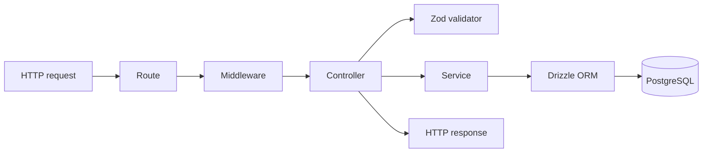
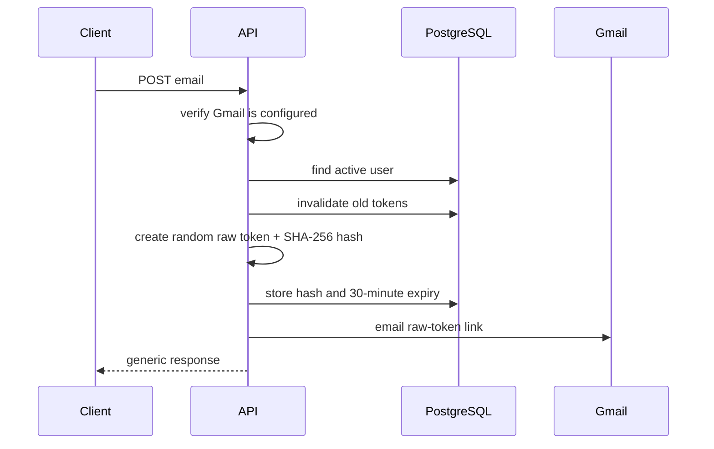
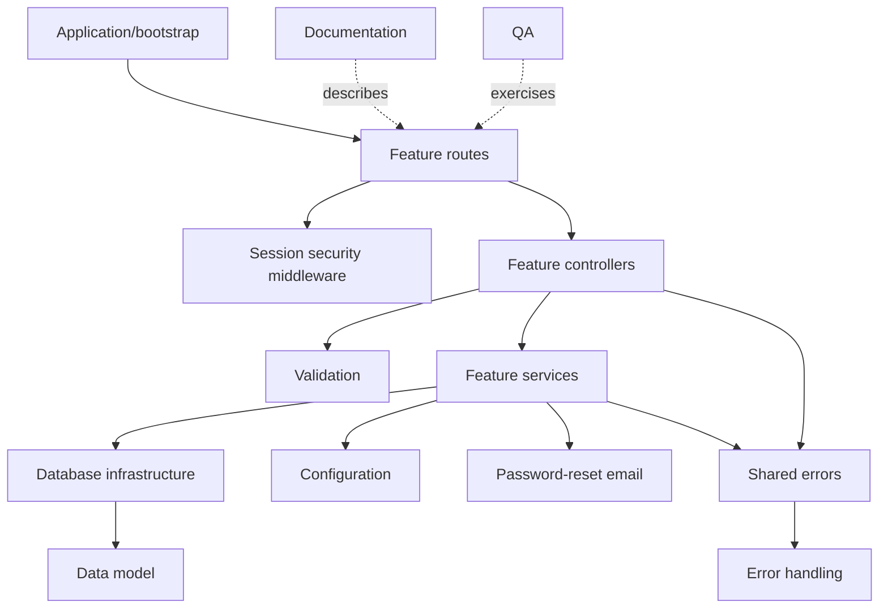

# Express Task API — Module Guide

This guide explains the project as a collection of **conceptual modules**.

The folders are physically organized by technical layer:

```text
routes/
controllers/
services/
validators/
db/schema/
```

However, the actual product is made of features such as Authentication, Profiles, Password Recovery, and Administration. A feature's files are therefore spread across several layer folders.

This document shows where each conceptual module lives, what it owns, how data passes through it, what it is allowed to depend on, and why its important decisions were made.

## 1. Layer-based organization versus module-based organization

### What the project currently uses

The current repository is organized **by layer**:

```text
src/
  routes/
  controllers/
  services/
  validators/
  db/schema/
```

Files with the same technical responsibility are grouped together. All routes live together, all services live together, and so on.

For example, the Profile feature is spread across:

```text
routes/profile.routes.ts
controllers/profile.controllers.ts
services/profile.service.ts
validators/profile.validators.ts
db/schema/profiles.schema.ts
```

### What module-based organization would look like

A feature-first version might look like:

```text
src/modules/
  profile/
    profile.routes.ts
    profile.controllers.ts
    profile.service.ts
    profile.validators.ts
    profile.schema.ts
```

The behavior could remain exactly the same. Only the physical file grouping would change.

### Why layer-based organization was reasonable here

- It makes the route → controller → service pattern easy to learn.
- The project is still small enough that each layer contains only a few files.
- Similar technical code is easy to compare.
- Cross-cutting infrastructure is easy to find.
- It avoids introducing module barrels, dependency boundaries, and nested folder complexity too early.

### When feature modules become more useful

Feature-first organization becomes more valuable when:

- a feature has many files;
- multiple developers own different features;
- layer folders become crowded;
- changing one feature requires jumping through too many unrelated files;
- features need stronger dependency boundaries;
- parts of the system may later be extracted into separate services.

The key idea is:

> The project already has conceptual modules even though the folders are organized by layer.

## 2. What each technical layer does

Every feature normally travels through the same set of layers.



### Routes

Routes define the public HTTP interface:

- method;
- path;
- middleware order;
- controller function.

A route should not contain large business rules.

### Middleware

Middleware handles rules shared by many endpoints, such as:

- parsing request bodies;
- verifying JWTs;
- loading the authenticated user;
- checking roles;
- formatting errors.

### Controllers

Controllers translate between HTTP and application logic:

- read request data;
- validate it;
- call a service;
- select a response status;
- build a safe response.

Controllers should not contain complex database workflows.

### Validators

Validators define what untrusted request data is allowed to look like.

They protect the application from:

- missing fields;
- invalid formats;
- overly long values;
- unsupported enum values;
- unexpected fields;
- malformed identifiers.

### Services

Services implement business decisions:

- hash or compare passwords;
- perform transactions;
- enforce state transitions;
- create reset tokens;
- protect the final administrator;
- select safe database fields.

### Database schemas

Schemas define persistent structure:

- tables;
- columns;
- enums;
- constraints;
- indexes;
- foreign keys;
- cascades.

### Shared infrastructure

Infrastructure code provides resources used by many modules:

- environment configuration;
- database connection pool;
- error types;
- OpenAPI loading;
- shared Express request types.

## 3. Conceptual module map

| Module | Main responsibility | Main persistent data |
| --- | --- | --- |
| Application/bootstrap | Assemble and start the server | None |
| Configuration | Validate deployment settings | Environment variables |
| Database infrastructure | Connect Drizzle to PostgreSQL | All tables |
| Authentication | Signup, signin, signout, reactivation | `users`, `profiles` |
| Session security | Verify JWTs and invalidate sessions | `users.token_version` |
| Password recovery | Email reset links and consume tokens | `password_reset_tokens`, `users` |
| Account management | Read account, change password, deactivate/delete | `users` |
| Profile | Read and update public profile information | `profiles` |
| Administration/RBAC | Manage other users safely | `users`, `profiles` |
| Validation | Validate all external input | None |
| Error handling | Convert failures into safe HTTP responses | None |
| Documentation | Serve OpenAPI and Swagger UI | `openapi.yaml` |
| Database migrations | Evolve database structure | Migration history |
| QA/Postman | Exercise public behavior | Disposable test records |

## 4. Application and bootstrap module

### Files

```text
src/server.ts
src/app.ts
```

### Responsibility

This module creates the Express application, installs global middleware, mounts feature routers, and starts the HTTP listener.

### Startup flow

```text
npm run dev
    ↓
tsx executes src/server.ts
    ↓
server.ts imports app.ts
    ↓
app.ts creates and configures Express
    ↓
server.ts listens on PORT or 5000
```

### What `app.ts` configures

- disables `X-Powered-By`;
- parses JSON bodies up to 100 KB;
- parses reset-form bodies up to 10 KB;
- serves the root endpoint;
- serves `openapi.yaml`;
- serves the reset-password HTML page;
- serves Swagger UI;
- mounts system, authentication, user, profile, and admin routers;
- installs the 404 handler;
- installs the final error handler.

### Decisions

#### `app.ts` and `server.ts` are separate

`app.ts` builds the application while `server.ts` starts the network listener. This separation makes the Express application easier to import into future automated tests without opening a real port.

#### Error middleware is last

Errors must be created before they can be handled. Therefore route mounting happens before the not-found and error handlers.

#### Request size limits exist

The server does not accept unlimited request bodies. This reduces accidental memory use and some denial-of-service risk.

#### The reset form is outside `/api/v1`

`/reset-password` is a small browser page rather than a JSON API resource. The API version remains under `/api/v1/auth/reset-password` for programmatic clients.

## 5. Configuration module

### File

```text
src/config/env.ts
```

### Responsibility

Convert raw strings from `process.env` into validated application configuration.

### Settings it owns

- JWT secret, expiry, issuer, and audience;
- bcrypt work factor;
- Gmail username and App Password;
- public application base URL.

Database connection validation begins in `src/db/index.ts` because that module directly owns `DATABASE_URL`.

### Decisions

#### Fail during startup

A malformed secret or URL causes startup to fail instead of allowing the server to run in a partially broken state.

#### Gmail variables are all-or-nothing

Providing only a username or only an App Password is rejected. A half-configured email module cannot work correctly.

#### Gmail App Password spaces are removed

Google may display an App Password in grouped characters. Removing whitespace prevents a formatting mistake from breaking authentication.

#### JWT duration is parsed explicitly

Only values such as `15m`, `1h`, or `1d` are accepted. Ambiguous or negative durations are rejected.

### Dependencies

This module depends only on `dotenv` and built-in JavaScript behavior. Feature modules may depend on configuration, but configuration should not depend on feature modules.

## 6. Database infrastructure module

### File

```text
src/db/index.ts
```

### Responsibility

- read `DATABASE_URL`;
- create the Postgres.js client;
- provide the connection pool;
- create the Drizzle database object;
- register all schemas with Drizzle;
- export the raw client for controlled shutdown scripts.

### Data flow

```text
Service
  ↓
Drizzle db object
  ↓
Postgres.js connection pool
  ↓
PostgreSQL
```

### Connection-pooling decision

`postgres(connectionString)` already creates a Postgres.js connection pool. The project does not add another pool library.

The installed driver opens connections lazily and allows up to ten by default. Drizzle sends queries through that pooled client.

Transactions reserve one connection for the entire transaction so its queries cannot be split across unrelated connections.

### Schema registration

The Drizzle instance receives:

- `users`;
- `profiles`;
- `passwordResetTokens`.

Registering the schema gives Drizzle knowledge of table types and relationships for typed queries.

### Decisions

#### One shared client

Creating a new database client in every service would create multiple pools and waste connections. The application imports one shared `db` object.

#### No pool maximum is hardcoded yet

The default is enough locally. Production pool size should be selected using the database provider's limit and the number of running app instances.

#### Scripts close the client

The admin seed explicitly calls `client.end()` because a short-lived script must close its pool before the Node.js process can exit cleanly.

## 7. Data model module

### Files

```text
src/db/schema/users.schema.ts
src/db/schema/profiles.schema.ts
src/db/schema/password-reset-tokens.schema.ts
```

### Relationships

```text
users 1 ───── 1 profiles
users 1 ───── * password_reset_tokens
```

### User model

Owns identity and security state:

- normalized unique email;
- password hash;
- token version;
- account status;
- role;
- timestamps.

Decisions:

- UUID primary keys are generated by PostgreSQL.
- Roles and statuses are PostgreSQL enums.
- A database constraint enforces lowercase trimmed email.
- Plain passwords are never stored.
- `token_version` invalidates old JWTs.

### Profile model

Owns editable presentation data:

- display name;
- biography;
- avatar URL.

Decisions:

- `user_id` is unique, producing one profile per user.
- Profile data is separate from security data.
- Deleting a user cascades to the profile.

### Password-reset-token model

Owns forgotten-password recovery state:

- user foreign key;
- unique token hash;
- expiry time;
- used/invalidation time;
- creation time.

Decisions:

- only the SHA-256 hash is stored;
- raw tokens exist only in email links and requests;
- one user may have several historical token records;
- unused records are invalidated when a new request is created;
- deleting a user cascades to reset tokens;
- `user_id` is indexed because reset operations filter by it.

## 8. Authentication module

### Files

```text
src/routes/auth.routes.ts
src/controllers/auth.controllers.ts
src/services/auth.service.ts
src/validators/auth.validators.ts
```

Some password-recovery behavior also uses the Password Recovery module described later.

### Public interface

```text
POST /api/v1/auth/signup
POST /api/v1/auth/signin
POST /api/v1/auth/signout
POST /api/v1/auth/reactivate
```

The same router also exposes forgot/reset-password endpoints, but those are treated as a separate conceptual module because they have distinct security and email responsibilities.

### Signup

#### Input

- email;
- password;
- display name;
- optional bio;
- optional avatar URL.

#### Flow

```text
route
  → signup controller
  → signupSchema
  → signupUser service
  → bcrypt hash
  → transaction inserts user and profile
  → 201 response
```

#### Decisions

- The body is strict, so `role` and other unknown fields are rejected.
- Public signup always receives the database default role `user`.
- User and profile creation are atomic through a transaction.
- Passwords are hashed before storage.
- The returned user contains safe fields only.

### Signin

#### Flow

1. Normalize and validate email.
2. Find the user.
3. Compare submitted password with bcrypt hash.
4. Reject deactivated accounts.
5. Sign a short-lived JWT.
6. Return safe user data and token metadata.

#### Decisions

- Unknown email and incorrect password return the same message.
- Role is returned to the client but is not embedded in the JWT.
- The current database role is loaded on every authenticated request.
- Deactivated users cannot receive usable sessions.

### Signout

Signout increments `token_version`. The client should also delete its local copy of the JWT.

The backend cannot physically retrieve a signed stateless JWT from another device, so version invalidation is used instead.

### Reactivation

Reactivation is public because a deactivated user's old JWT is rejected.

It requires:

- normalized email;
- correct password;
- currently deactivated state.

It changes status to `active` and increments `token_version` so older tokens remain invalid.

### Module dependencies

Authentication depends on:

- environment configuration;
- database infrastructure;
- user/profile/reset-token schemas;
- bcrypt;
- JWT library;
- shared errors;
- security-token utilities;
- password-reset email service.

## 9. Session-security and authentication-middleware module

### Files

```text
src/middlewares/auth.middlewares.ts
src/types/express.d.ts
```

### Responsibility

- verify Bearer tokens;
- validate token payload structure;
- load current database security state;
- reject stale or deactivated sessions;
- attach the trusted current user to the request;
- enforce allowed roles.

### Authentication flow

```text
Authorization: Bearer <JWT>
  ↓
verify signature, algorithm, issuer, audience, expiry
  ↓
validate subject UUID and tokenVersion
  ↓
load user from PostgreSQL
  ↓
compare database and JWT token versions
  ↓
verify active status
  ↓
attach req.user
```

### `req.user`

The trusted request identity contains:

```ts
{
  id: string;
  email: string;
  role: "user" | "admin";
}
```

Express does not know about this property by default. `src/types/express.d.ts` augments its TypeScript definition.

### Authorization flow

`authorizeRoles("admin")` runs after `authenticate`.

- no authenticated user → 401;
- authenticated but wrong role → 403;
- allowed role → continue.

### Decisions

#### Database-backed role

The JWT does not contain the trusted role. Promotion and demotion therefore take effect immediately after the database change.

#### Token version in JWT

The version makes stateless access tokens revocable as a group.

#### HS256 is explicitly required

Verification accepts only the expected signing algorithm instead of trusting the token header to select an arbitrary algorithm.

#### Authentication and authorization are separate

Knowing who someone is does not automatically grant admin permissions.

## 10. Password Recovery module

### Files

```text
src/controllers/password-reset-page.controllers.ts
src/services/password-reset-email.service.ts
src/utils/security-tokens.ts
src/db/schema/password-reset-tokens.schema.ts
```

It also uses forgot/reset functions and validators from the Authentication module.

### Public interface

```text
POST /api/v1/auth/forgot-password
POST /api/v1/auth/reset-password
GET  /reset-password
POST /reset-password
```

### Why it is conceptually separate

Password recovery combines several responsibilities not required for normal signin:

- generating cryptographic tokens;
- storing token hashes;
- token expiry and single-use behavior;
- sending Gmail messages;
- serving a tiny HTML form;
- protecting against account enumeration;
- invalidating all previous sessions.

### Forgot-password flow



### Reset flow

1. User opens the emailed link.
2. The HTML page validates token format.
3. User submits a new password.
4. Service hashes the raw token.
5. Matching database row is checked.
6. New password is bcrypt-hashed.
7. Transaction locks and validates the token again.
8. Password and token version are updated.
9. All outstanding tokens for the user are marked used.

### Decisions

#### Generic forgot-password response

The endpoint does not reveal whether a particular email exists. This reduces account enumeration.

#### 503 when Gmail is globally unconfigured

Configuration is checked before account lookup. Every email gets the same 503 in that state, so existence is still not revealed.

#### Raw reset token is never stored

Only a SHA-256 hash is persisted. A database leak alone does not expose usable reset links.

#### Token is validated twice

The preliminary check avoids unnecessary bcrypt work for obviously invalid tokens. The second check occurs after locking the row inside a transaction, preventing simultaneous reuse.

#### All tokens are consumed after success

Resetting a password invalidates every outstanding reset attempt, not just the submitted record.

#### Delivery failure invalidates the token

If Gmail rejects the message, the created token is marked used so an undelivered reset attempt cannot remain active.

#### Only error type is logged

Email address, token, email contents, password, and Gmail credentials are excluded from error logs.

#### Tiny server-rendered form

A clickable email link needs a place to enter the new password. The project serves one minimal page rather than requiring a complete frontend.

#### Security headers on the form

The response uses no-store caching, a restrictive Content Security Policy, no-referrer policy, and MIME sniffing protection.

## 11. Account Management module

### Files

```text
src/routes/user.routes.ts
src/controllers/user.controllers.ts
src/services/user.service.ts
src/validators/user.validators.ts
```

### Public interface

```text
GET    /api/v1/users/me
PATCH  /api/v1/users/me/password
POST   /api/v1/users/me/deactivate
DELETE /api/v1/users/me
```

Every endpoint requires authentication.

### Get current account

Returns:

- ID;
- email;
- role;
- creation/update timestamps.

It intentionally excludes:

- password hash;
- token version;
- reset-token records.

### Change password

Requires current and new passwords.

Decisions:

- current-password confirmation protects unattended authenticated sessions;
- unchanged password is rejected;
- new password is bcrypt-hashed;
- token version increases, signing out all old sessions.

### Self-deactivation

Requires current password. It retains user/profile data, changes status, and invalidates sessions.

The account can later be reactivated with valid credentials.

### Self-deletion

Requires current password. It permanently removes the user. Foreign-key cascades remove the profile and reset tokens.

### Last-admin protection

Self-deactivation/deletion participates in the same active-admin row-locking rule as administrative management. The final active administrator cannot remove themselves.

### Decisions

#### Deactivation and deletion are separate

Deactivation is reversible and preserves data. Deletion is irreversible.

#### Password confirmation occurs before destructive transactions

The service verifies the caller's secret before changing account state.

#### Safe user selection is explicit

The service chooses returned columns rather than returning the full database user object.

## 12. Profile module

### Files

```text
src/routes/profile.routes.ts
src/controllers/profile.controllers.ts
src/services/profile.service.ts
src/validators/profile.validators.ts
src/db/schema/profiles.schema.ts
```

### Public interface

```text
GET   /api/v1/users/me/profile
PATCH /api/v1/users/me/profile
```

The router applies `authenticate` once with `router.use`, so every route beneath it is protected.

### Read flow

The service joins `profiles` with `users`:

```text
profiles.user_id = users.id
```

This lets the response include the authoritative email without duplicating email inside the profile table.

### Update flow

- validate at least one supported field;
- update only supplied fields;
- update `updated_at`;
- read the joined profile again;
- return the consistent response shape.

### Decisions

#### Partial update uses PATCH

The client can update one field without resending the entire profile.

#### Empty updates are rejected

`{}` would change nothing, so validation requires at least one field.

#### Unknown fields are rejected

Profile update cannot be used to change email, role, status, or security data.

#### Null and missing are different

- missing field: leave the stored value unchanged;
- explicit `null`: clear optional bio/avatar fields.

## 13. Administration and RBAC module

### Files

```text
src/routes/admin.routes.ts
src/controllers/admin.controllers.ts
src/services/admin.service.ts
src/validators/admin.validators.ts
src/scripts/seed-admin.ts
```

### Public interface

```text
GET    /api/v1/admin/users
GET    /api/v1/admin/users/:userId
PATCH  /api/v1/admin/users/:userId/role
POST   /api/v1/admin/users/:userId/deactivate
POST   /api/v1/admin/users/:userId/reactivate
DELETE /api/v1/admin/users/:userId
```

The router applies:

```ts
router.use(authenticate, authorizeRoles("admin"));
```

Every endpoint therefore requires both identity and current admin authorization.

### Listing/search module behavior

The list endpoint supports:

- page default 1;
- limit default 20;
- limit maximum 100;
- email/display-name search;
- role filter;
- status filter;
- newest-first deterministic order;
- pagination metadata.

Search uses case-insensitive PostgreSQL matching.

### Detail behavior

Returns a safe combined user/profile view. It excludes password hashes, token versions, and reset tokens.

### Mutation behavior

Role changes, deactivation, and reactivation increment the target's token version.

Deletion relies on database cascades.

Repeated or meaningless state changes return 409, for example:

- promoting an existing admin to admin;
- deactivating an already-deactivated user;
- reactivating an active user.

### Self-target decision

An admin cannot use admin endpoints on their own ID. Personal account operations use password-confirmed `/users/me` routes.

This keeps “manage another user” and “manage myself” as separate security workflows.

### Last-active-admin decision

Sensitive transactions:

1. lock all active admins in deterministic ID order;
2. confirm the actor remains an active admin;
3. lock the target;
4. verify state again;
5. reject removal of the final active admin;
6. perform the mutation.

The locks protect the invariant even under simultaneous requests.

### Initial administrator seed

There is no public “become admin” endpoint.

The trusted seed:

- reads admin values from environment variables;
- validates them;
- refuses to promote an existing normal user;
- does nothing if the admin already exists;
- hashes the password;
- creates admin and profile transactionally;
- closes the database client afterward.

## 14. Validation module

### Files

```text
src/validators/auth.validators.ts
src/validators/user.validators.ts
src/validators/profile.validators.ts
src/validators/admin.validators.ts
```

### Responsibility

Define runtime contracts for all untrusted input.

### Shared decisions

#### Strict objects

Unknown fields are rejected. This prevents accidental mass assignment such as including `role` in signup.

#### Email normalization

Email is trimmed and converted to lowercase before services receive it.

#### bcrypt byte limit

Passwords are limited to 72 characters and 72 UTF-8 bytes because bcrypt only processes its supported byte length.

#### UUID validation

Admin target IDs are validated before database queries.

#### Query coercion

URL query values arrive as strings. Admin page/limit values are deliberately converted to integers and range-checked.

#### Optional versus nullable

- optional: field may be absent;
- nullable: field may explicitly contain `null`.

### Why validators are a separate module

TypeScript types disappear at runtime. Network input is untrusted JavaScript data, so Zod must verify it before services use it.

## 15. Error Handling module

### Files

```text
src/errors/app-error.ts
src/middlewares/error.middlewares.ts
```

### Responsibility

Convert different failure sources into consistent, safe JSON responses.

### Error categories

- malformed JSON → 400;
- Zod validation → 400 with field errors;
- expected `AppError` → selected status/message;
- PostgreSQL unique conflict → 409;
- foreign-key conflict → 409;
- database constraint violation → 400;
- missing route → 404;
- unexpected error → generic 500.

### PostgreSQL error unwrapping

Drizzle may wrap the original driver error inside `cause`. The middleware checks several cause levels to find a `PostgresError` and map known database codes.

### Decisions

#### One final error formatter

Controllers and services throw errors instead of duplicating response formatting everywhere.

#### Expected and unexpected failures are different

`AppError` represents a known business outcome. Unknown errors do not expose their original message to clients.

#### Sensitive logs are minimized

Unexpected logs include only error type, not SQL text, passwords, tokens, or request bodies.

## 16. API Documentation module

### Files

```text
openapi.yaml
src/docs/swagger.ts
```

### Responsibility

- define the public API contract;
- describe request/response schemas;
- describe Bearer authentication;
- document error cases;
- expose raw YAML;
- provide interactive Swagger UI.

### Data flow

```text
openapi.yaml
  ↓ parsed at startup
openApiDocument
  ↓
Swagger UI at /api-docs/
```

The raw file is also served from `/openapi.yaml`.

### Decisions

#### Specification is stored as YAML

YAML keeps a standards-compatible contract independent from controller implementation.

#### Swagger authorization is persistent in the page

`persistAuthorization` avoids repeatedly entering a token during manual exploration.

#### Documentation must change with code

Adding/removing endpoints or response fields requires updating OpenAPI. Otherwise consumers receive an incorrect contract.

## 17. Database Migration module

### Files

```text
drizzle/*.sql
drizzle/meta/*.json
drizzle/meta/_journal.json
drizzle.config.ts
```

### Responsibility

Move any database from its old schema version to the current version in a repeatable order.

### Current history

- `0000`: initial users/profiles;
- `0001`: account lifecycle and original email-token structures;
- `0002`: user/admin roles;
- `0003`: remove the broader email system;
- `0004`: reintroduce only simple password-reset tokens.

### Decisions

#### Applied migrations are immutable

Requirements changed, but old migrations were not rewritten. Forward migrations preserve the same history for existing and fresh databases.

#### TypeScript schema describes the final state

Migration history explains how the database arrived there. The files under `src/db/schema` describe what the database should look like now.

#### Generated SQL is inspected before application

Schema generation is not a substitute for reviewing destructive operations.

### Workflow

```bash
npx drizzle-kit generate
npx drizzle-kit migrate
npx drizzle-kit check
```

## 18. QA and Postman module

### Files

```text
postman/Express Task API.postman_collection.json
postman/Express Task API.postman_environment.json
postman/README.md
```

### Responsibility

- provide reusable request examples;
- capture tokens and IDs into environment variables;
- generate unique disposable emails;
- exercise normal and failure cases;
- document manual password-reset testing.

### Automated coverage

- signup role rejection;
- normal signup/signin/profile operations;
- admin signin;
- unauthenticated 401;
- normal-user 403;
- filtering and pagination;
- invalid queries/UUIDs/roles;
- promotion and demotion;
- JWT invalidation;
- last-admin protection;
- deactivation/reactivation;
- permanent deletion.

### Decisions

#### Disposable users

Unique generated emails prevent collisions between collection runs.

#### Destructive operations are last

The target must exist for earlier tests, so deletion occurs at the end.

#### Gmail flow is manual

Real delivery needs private credentials and an inbox. The collection provides the requests without claiming delivery succeeded automatically.

## 19. System/Demo module

### File

```text
src/routes/demo.routes.ts
```

### Public interface

```text
GET  /api/v1/health
POST /api/v1/echo
```

### Purpose

- health proves the HTTP server responds;
- echo demonstrates body parsing;
- both provide simple first endpoints for learning/testing.

### Decision

They were retained because this is a training project. A production health endpoint might additionally distinguish liveness from database readiness.

## 20. Cross-module dependency map



### Healthy dependency direction

```text
routes → controllers → services → database
                  ↘ validators
shared configuration/errors ← used by feature modules
```

Lower layers should not import controllers or routes. The database layer should not know about HTTP requests.

### Existing intentional sharing

- Auth and account modules share the `users` table.
- Signup uses the Profile data model transactionally.
- Password Recovery uses functions inside the Auth service.
- Admin uses both user and profile models.
- Every protected feature uses Authentication middleware.
- Every feature uses centralized Error Handling.

## 21. One request through every layer

Example: administrator deactivates another user.

```text
POST /api/v1/admin/users/:userId/deactivate
```

1. `app.ts` sends the path to `adminRouter`.
2. `authenticate` verifies JWT and loads current role.
3. `authorizeRoles("admin")` checks permission.
4. Admin controller validates `userId` as UUID.
5. Controller calls `deactivateAdminUser`.
6. Service rejects self-targeting.
7. Transaction locks active administrators.
8. Service locks and validates the target.
9. Service changes status and increments token version.
10. Transaction commits.
11. Controller returns 200.
12. Any old target JWT now returns 401.

This example shows that a “module” is not one file. It is a coordinated path across layers.

## 22. How this could be reorganized by feature later

A future feature-first structure could be:

```text
src/
  modules/
    auth/
      auth.routes.ts
      auth.controllers.ts
      auth.service.ts
      auth.validators.ts
    account/
      account.routes.ts
      account.controllers.ts
      account.service.ts
      account.validators.ts
    profile/
      profile.routes.ts
      profile.controllers.ts
      profile.service.ts
      profile.validators.ts
    password-recovery/
      password-recovery.routes.ts
      password-recovery.controllers.ts
      password-recovery.service.ts
      password-recovery.validators.ts
      password-reset-email.service.ts
    admin/
      admin.routes.ts
      admin.controllers.ts
      admin.service.ts
      admin.validators.ts
  shared/
    config/
    db/
    errors/
    middleware/
    docs/
```

### What would not change

- endpoint URLs;
- request/response formats;
- database schema;
- security behavior;
- migrations;
- tests.

This would be a structural refactor, not a feature change.

### Safe refactor order

1. Move one complete feature at a time.
2. Update imports without changing behavior.
3. Run typecheck after each feature.
4. Run Postman regression tests.
5. Keep shared infrastructure independent.
6. Avoid mixing folder movement with API/schema changes.

### When not to refactor

Do not reorganize only because another structure looks more professional. Refactor when the current structure causes real navigation, ownership, or dependency problems.

## 23. Module boundaries and ownership rules

### Authentication owns

- credentials and signin;
- JWT creation;
- signup transaction;
- signout/reactivation;
- password-reset orchestration currently located in its service.

### Session Security owns

- JWT verification;
- trusted current-user loading;
- role middleware;
- request identity type.

### Password Recovery owns

- reset tokens;
- Gmail reset message;
- browser reset form;
- single-use/expiry behavior.

### Account owns

- current account view;
- logged-in password change;
- self-deactivation;
- self-deletion.

### Profile owns

- display name;
- biography;
- avatar URL.

### Admin owns

- managing other users;
- search/pagination;
- role changes;
- admin state transitions;
- last-admin invariants;
- trusted bootstrap.

### Infrastructure owns

- database connections;
- environment parsing;
- generic error formatting;
- migration/application startup concerns.

Clear ownership prevents two modules from implementing different versions of the same rule.

## 24. Important decisions across all modules

### Security rules live in services or middleware

Controllers should not be the only place protecting a business invariant. Services remain responsible for transactions and state rules.

### Database constraints support application validation

Zod improves client errors; PostgreSQL constraints protect data even if another client bypasses the API.

### Responses select safe fields

The application avoids returning entire database records containing hashes or security counters.

### State changes invalidate sessions

Password, role, and account-status mutations increment `token_version`.

### Transactions protect multi-step invariants

Signup, password reset, last-admin protection, and sensitive admin operations are atomic.

### Modules share infrastructure, not HTTP details

Services receive IDs and validated input rather than Express request/response objects.

### Small training scope is intentional

The system omits refresh tokens, MFA, rate limiting, persistent audit logs, and production email infrastructure. Those boundaries are documented instead of hidden.

## 25. How to study one module

Use this repeatable order:

1. Start with the route to learn the public interface.
2. Identify authentication/authorization middleware.
3. Read the controller to see input and response behavior.
4. Read the Zod validator.
5. Read the service business rules.
6. Read the tables/columns the service uses.
7. Read the OpenAPI definition.
8. Execute the request in Postman.
9. Observe the database change in Drizzle Studio.

For example, study Profile like this:

```text
profile.routes.ts
  → profile.controllers.ts
  → profile.validators.ts
  → profile.service.ts
  → profiles.schema.ts
  → OpenAPI
  → Postman
  → Drizzle Studio
```

## 26. Questions for checking your understanding

- What is the difference between a technical layer and a feature module?
- Why is the Profile module spread across five layer folders?
- Why should a route not perform database transactions directly?
- Why does Authentication depend on Profile during signup?
- Why is Password Recovery conceptually separate from ordinary signin?
- Why does Session Security load roles from PostgreSQL?
- Why does Admin lock active administrator rows?
- Why are Zod and PostgreSQL constraints both needed?
- Why does the database module export one shared client?
- Why is another connection-pool library unnecessary?
- Which parts could move during a feature-first refactor without changing behavior?

If you can trace one request across route, middleware, controller, validator, service, and database—and explain which conceptual module owns each rule—you understand both the current layer architecture and the module boundaries inside it.
